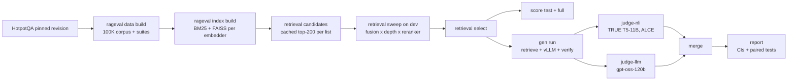

# Architecture

## Serving path

```mermaid
flowchart LR
  client([client]) -->|POST /v1/answer| api[FastAPI]
  api --> graph
  subgraph graph[LangGraph agent]
    direction LR
    R[retrieve<br/>BM25 + FAISS HNSW<br/>RRF / weighted fusion] -->|rerank on, budget ok| RR[rerank<br/>cross-encoder]
    R -->|rerank off or behind deadline| F[fuse_only]
    RR --> G[generate<br/>FallbackRouter]
    F --> G
    G -->|claims, budget ok| V[verify<br/>NLI citation repair]
    G -->|abstained or no verifier| Z[finalize]
    G -->|behind deadline| SV[skip_verify]
    V --> Z
    SV --> Z
  end
  G <-->|primary| P[(vLLM Qwen3-8B)]
  G <-->|overflow / deadline / hedge / breaker| FB[(vLLM Qwen3-1.7B)]
  R -. micro-batch .-> E[embedder]
  RR -. micro-batch .-> CE[reranker]
  V -. micro-batch .-> N[NLI]
  api --> M[/metrics Prometheus/]
  api --> T[OTel spans + JSONL trace log]
```

- **Retrieval**: BM25 (bm25s, Lucene scoring, Snowball stemming) runs in a thread pool while the
  query is embedded (micro-batched across concurrent requests) and searched in a FAISS HNSW index.
  Lists are fused with reciprocal rank fusion or a min-max weighted sum; the fused head is
  reranked by a cross-encoder.
- **Generation**: the prompt shows the top-k documents numbered `[1]..[k]` and requires a citation on
  every sentence. `FallbackRouter` (`src/rageval/llm/router.py`) sits between the agent and the two
  vLLM endpoints and implements:
  - circuit breaker: consecutive primary failures open the breaker; half-open probes close it;
  - retry: a failed or timed-out primary call is retried once on the fallback;
  - overflow, deadline and hedging policies (load-based routing to the fallback), all off in the
    measured deployment: with the fallback sharing the primary's GPU they made p95 worse
    (`docs/RESULTS_LOG.md`).
- **Stage fallbacks** (`adaptive: true`): when the reranker is backed up the graph reranks 15 instead
  of 30 candidates; when the verifier is backed up or the request is already late, verification
  checks only the cited documents and prunes what fails instead of running the repair search. Both
  are recorded in the response, the trace log and `rag_degraded_total`. The trace logs are what
  located the tail: the slowest 10% of requests at 50 QPS spent most of their time in the
  verifier's repair search and in primary queueing.
- **Verification**: each statement's citations are checked with an NLI model. Unnecessary
  citations are dropped, unsupported ones re-attached to the context document (or pair) that
  entails the statement, and statements nothing supports are pruned (or kept, policy `repair`).

## Observability

- One OpenTelemetry root span per request (`rag.request`) with a child span per graph node, carrying
  route, fallback reason, tokens and remaining budget. Exported to JSONL and, when
  `RAG_OTLP_ENDPOINT` is set, over OTLP/HTTP (Jaeger in `deploy/docker-compose.yml`).
- A JSONL trace log line per request: node timings, route, reason, degraded stages, token counts,
  verifier actions. Written by a background thread.
- Prometheus: request latency by route, per-node latency, route decisions by reason, degraded
  stages, in-flight requests per endpoint, breaker state, tokens. Grafana dashboard in
  `deploy/grafana/dashboards/rag-agent.json`.

## Offline evaluation path



## Compute

- Development, unit tests, lint and the CPU smoke test of the job chain run in a container on a
  Linux box (`scripts/dev.sh`, `scripts/smoke_pipeline.sh`).
- GPU work runs on Northeastern's Explorer cluster (H200 / A100 nodes) through Slurm. Every job
  runs the unit tests on the GPU node first, then one stage script from `scripts/`
  (`slurm/gpu.sbatch`). Jobs run a `git archive` of one commit, and its SHA is recorded in every
  results file.
